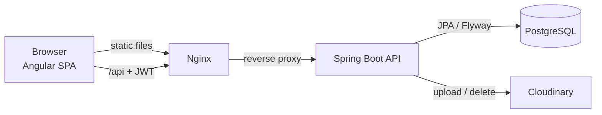

# Dress Inventory

[](https://github.com/dobrosavljevicnenad/dress-inventory/actions/workflows/ci.yml)

Inventory and order management for a dress boutique: product catalog with stock per color,
concurrency-safe ordering, payment screenshots and an admin dashboard.

The project started as a **Node.js/Express + MongoDB** service and was **migrated to Java 21 and
Spring Boot 4** with PostgreSQL, keeping the REST API compatible with the existing Angular client.
The original implementation is preserved in [`legacy-node/`](legacy-node) for reference.

## Tech stack

| Area | Technologies |
| --- | --- |
| Backend | Java 21, Spring Boot 4.1, Spring MVC, Spring Data JPA (Hibernate 7), Bean Validation |
| Database | PostgreSQL 17, Flyway migrations |
| Security | Spring Security 7, stateless JWT (OAuth2 resource server, HS256), BCrypt-ready admin credentials |
| API | REST, RFC 9457 Problem Details, OpenAPI 3 / Swagger UI (springdoc) |
| Frontend | Angular 17 (standalone components, signals, built-in control flow), Tailwind CSS, PWA |
| Media | Cloudinary behind an `ImageStorage` port |
| Testing | JUnit 5, Mockito, MockMvc, Testcontainers, Jasmine/Karma |
| Delivery | Docker (multi-stage, non-root), Docker Compose, Nginx reverse proxy, GitHub Actions |

## Architecture



The backend is organized by feature, each package owning its controller, service, repository and DTOs:

```
backend/src/main/java/io/github/dobrosavljevicnenad/dressinventory
├── auth      login endpoint, JWT issuing
├── dress     catalog, stock per color (entities, atomic stock queries, REST API)
├── order     order placement, order history
├── media     ImageStorage port, Cloudinary adapter, post-commit image cleanup
├── config    security, OpenAPI
└── common    error handling (Problem Details), shared exceptions
```

## Engineering highlights

**Oversell-safe stock reservation.** Stock is never read, changed in Java and written back. A single
conditional statement reserves it atomically:

```sql
update stock_item set quantity = quantity - :quantity
 where dress_id = :dressId and color = :color and quantity >= :quantity
```

PostgreSQL serializes concurrent updates of the same row and re-checks the condition, and a
`CHECK (quantity >= 0)` constraint guards the invariant at the database level.
[`OrderConcurrencyIT`](backend/src/test/java/io/github/dobrosavljevicnenad/dressinventory/order/OrderConcurrencyIT.java)
lets 20 buyers race for the last 5 items against a real PostgreSQL and asserts that exactly 5 orders succeed.

**All-or-nothing checkout.** A cart with several items is placed in one transaction: if a single line
cannot be fulfilled, every reservation is rolled back and no order is stored (409 Conflict).

**Server-side prices.** Order lines store a snapshot of name, image and price taken from the catalog.
The legacy API trusted the price sent by the client.

**Images deleted only after commit.** Removing a dress or an order publishes an event handled by a
`@TransactionalEventListener(phase = AFTER_COMMIT)`: a rolled-back transaction never deletes an image
that is still referenced, and a storage outage never fails the user's request.

**Stateless security with fail-fast configuration.** `POST /api/login` issues a signed JWT (2 h);
every other endpoint requires it. The application refuses to start without an admin password or with
a JWT secret shorter than 32 characters; the password supports `{bcrypt}` hashes.

**Backwards-compatible API.** The Java domain model uses English names while the JSON keeps the
original contract (`naziv`, `cena`, `lager`, ...) via `@JsonProperty`, so existing clients keep working.

**Schema owned by Flyway.** Hibernate runs with `ddl-auto=validate`, so every build verifies that the
entity mappings match the migrated schema.

## API

All endpoints except login require `Authorization: Bearer <token>`.
Interactive documentation: `http://localhost:8080/swagger-ui.html`.

| Method | Path | Description |
| --- | --- | --- |
| `POST` | `/api/login` | Exchange admin credentials for a JWT |
| `GET` | `/api/proveri-token` | Check that the current token is valid |
| `GET` | `/api/haljine` | List dresses with stock per color |
| `POST` | `/api/haljine` | Create a dress |
| `PUT` | `/api/haljine/{id}` | Update name, image, price or stock |
| `DELETE` | `/api/haljine/{id}` | Delete a dress (and its image) |
| `POST` | `/api/dodajKolicinu/{id}` | Add stock for a color (creates the color if missing) |
| `POST` | `/api/obrisi-boju/{id}` | Remove a color variant |
| `POST` | `/api/naruci/{id}` | Order one dress in one color |
| `POST` | `/api/naruci-vise` | Check out a cart (single transaction) |
| `GET` | `/api/narudzbine` | Order history, newest first |
| `DELETE` | `/api/narudzbine/{id}` | Delete one order line |
| `DELETE` | `/api/narudzbine/grupa?screenshot=` | Delete all lines of one checkout |
| `POST` | `/api/upload` | Upload an image (multipart field `slika`) |

Errors use Problem Details, e.g.:

```json
{ "type": "about:blank", "title": "Conflict", "status": 409,
  "detail": "Nema dovoljno na lageru za Lana (Crvena)", "error": "Nema dovoljno na lageru za Lana (Crvena)" }
```

## Running locally

### Everything in Docker

```bash
docker compose up --build
```

| Service | URL |
| --- | --- |
| Admin app | http://localhost:8081 (login `admin` / `admin`) |
| API + Swagger UI | http://localhost:8080/swagger-ui.html |
| PostgreSQL | `localhost:5433`, database/user/password `dress_inventory` / `dress` / `dress` |

Copy [`.env.example`](.env.example) to `.env` to set your own credentials or Cloudinary keys
(without Cloudinary the app runs normally, only image uploads answer 503).

### Development mode

```bash
docker compose up -d db                                     # PostgreSQL on localhost:5433

cd backend
./mvnw spring-boot:run -Dspring-boot.run.profiles=dev       # API on http://localhost:8080

cd frontend
npm ci && npm start                                         # app on http://localhost:4200
```

## Tests

```bash
cd backend && ./mvnw verify       # 28 unit/web tests + 6 integration tests (Testcontainers, needs Docker)
cd frontend && npm run test:ci    # 15 unit tests in headless Chrome
```

| Layer | What is covered |
| --- | --- |
| Unit | order rules (snapshot prices, insufficient stock, unknown color), stock normalization, Cloudinary URL parsing |
| Web | JSON contract, validation errors, 401 handling, JWT issuing and verification (`@WebMvcTest` + Spring Security) |
| Integration | full checkout flow, transaction rollback, concurrent ordering, post-commit image cleanup on PostgreSQL 17 |
| Frontend | HTTP interceptor, API client payloads, login flow, order grouping and date filter |

GitHub Actions runs all of them on every push and pull request, then builds both Docker images.

## Configuration

| Variable | Default | Description |
| --- | --- | --- |
| `DB_URL` / `DB_USERNAME` / `DB_PASSWORD` | `jdbc:postgresql://localhost:5432/dress_inventory`, `dress`, `dress` | Database connection |
| `APP_ADMIN_USERNAME` | `admin` | Admin login |
| `APP_ADMIN_PASSWORD` | required | Encoder-prefixed password, e.g. `{bcrypt}$2a$10$...` |
| `APP_JWT_SECRET` | required | HMAC secret, at least 32 characters |
| `APP_CORS_ALLOWED_ORIGINS` | `http://localhost:4200` | Comma-separated list of allowed origins |
| `CLOUDINARY_CLOUD_NAME` / `CLOUDINARY_API_KEY` / `CLOUDINARY_API_SECRET` | empty | Enable image uploads |

## Migration from Node.js

| Node.js / Express | Spring Boot |
| --- | --- |
| Express routers and controllers | `@RestController` per feature |
| Mongoose models (`Dress`, `Order`) | JPA entities (`Dress`, `StockItem`, `CustomerOrder`), Flyway schema |
| `$inc` / `$push` / `$pull` on embedded arrays | conditional `UPDATE`, `INSERT ... ON CONFLICT`, cleanup query |
| Mongo sessions for multi-item orders | `@Transactional` service methods |
| `jsonwebtoken` middleware | Spring Security OAuth2 resource server |
| `multer-storage-cloudinary` | `MultipartFile` + `ImageStorage` port with Cloudinary adapter |
| ad-hoc JSON errors | RFC 9457 Problem Details (with the legacy `error` field) |
| no tests | 34 backend tests, 15 frontend tests, CI pipeline |

Issues found and fixed during the migration:

- the client could set the order price; prices now always come from the catalog
- the frontend called `DELETE /api/narudzbine/{id}`, which did not exist in the old API
- grouped delete put a URL with encoded slashes into the path (rejected by Tomcat and Spring Security
  by default); it is now a query parameter
- credentials were committed in a `.env` file; they were removed and are validated at startup
- the order date filter in the client compared local dates with UTC midnight

## Roadmap

- Deployment to AWS (ECS Fargate, RDS for PostgreSQL, S3 + CloudFront for the frontend)
- Refresh tokens and multiple user accounts with roles
- Pagination and server-side filtering for the catalog and order history
